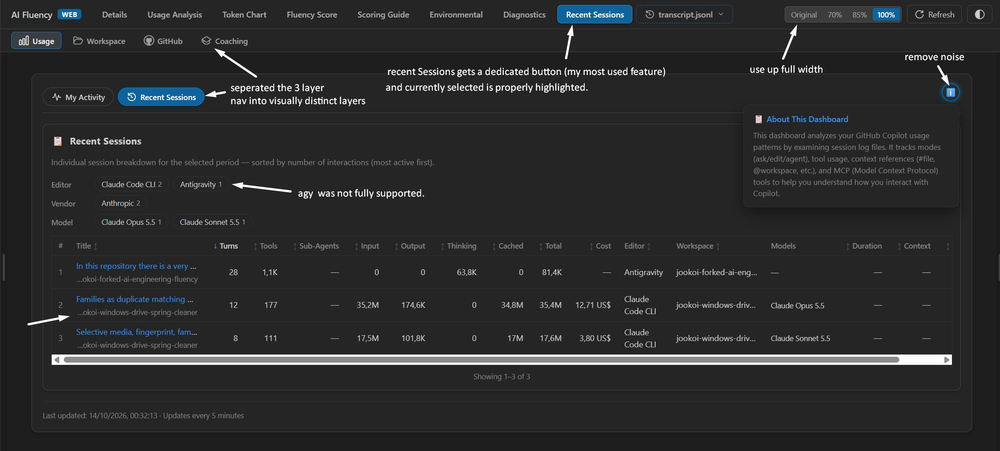
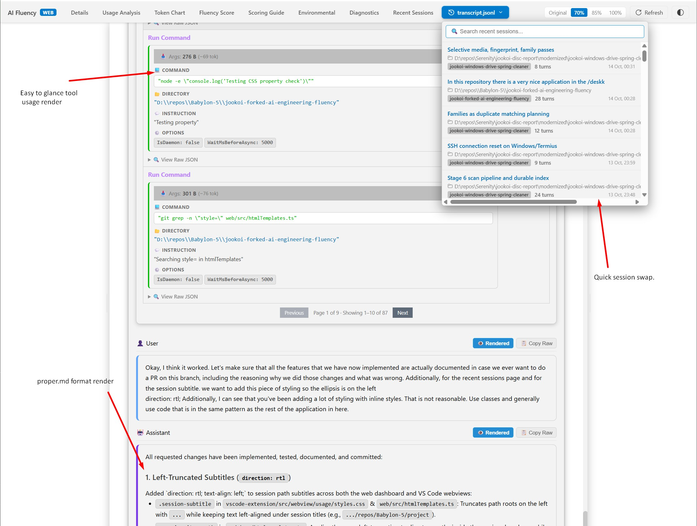

# AI Engineering Fluency (Browser Web Fork)

> **This repository is a fork of [rajbos/ai-engineering-fluency](https://github.com/rajbos/ai-engineering-fluency) introducing a browser-native standalone web application.**
>
> Run your entire token tracker, fluency scorecards, and session inspectors directly in your web browser at `http://localhost:3333` without opening a heavyweight editor (VS Code, Cursor) or relying on a desktop wrapper that lacks native browser search, zooming, URL bookmarks, and multi-tab workflows.

## Quick Start (Web Dashboard)

```bash
cd web
pnpm install
pnpm run build
pnpm start
# Open http://localhost:3333
```

## Screenshots

<p align="center">
  
</p>
<p align="center"><em>Recent Sessions overview with Antigravity session discovery, HydraFusion badges, and left-truncated folder path subtitles.</em></p>

<p align="center">
  
</p>
<p align="center"><em>Session inspector featuring rendered Markdown, structured tool argument cards, model metrics, execution tokens, and raw MD toggles.</em></p>

## Key Improvements & Additions in This Fork

### 1. Standalone Browser SPA Shell
- **Zero Full-Page Flashes**: A persistent application shell maintains top navigation, active tabs, and progress bars. View transitions swap isolated iframes without rebuilding the shell DOM.
- **Bi-Directional Route Synchronization**: URLs update as you browse (`/?view=usage`, `/?tab=chart`, `/session?file=...`). Direct links and browser refreshes reload the active view.
- **Multi-Tab Workflows**: Open multiple session logs simultaneously in separate browser tabs via middle-click or `Ctrl+Click` for side-by-side comparison.
- **3-Layer Navigation Hierarchy**:
  - Row 1: Primary modules (Details, Usage Analysis, Recent Sessions, Token Chart, Fluency Score, Scoring Guide, Environmental, Diagnostics, and a searchable session dropdown).
  - Row 2: Contextual sub-headers for Usage and Diagnostics groups.
  - Row 3: Inside-panel leaf pills.
- **Interactive Width Resizer**: Drag handles and presets (`Original`, `70%`, `85%`, `100%`) let you fit wide tables to your monitor.

### 2. Multi-Ecosystem Antigravity Support
- **Multi-Brain Discovery**: Scans `.gemini/antigravity/brain`, `.gemini/antigravity-cli/brain`, and `.gemini/antigravity-ide/brain` for session transcripts. Fixes the defect where CLI sessions were omitted from reports.
- **Directory Attribution**: Extracts real project working directories from transcript `Active Workspaces:` headers and tool call `Cwd` fields.
- **RTL Left-Truncated Subtitles**: Long folder paths use `direction: rtl, text-align: left` so the root truncates on the left (`.../repos/Babylon-5/project`), keeping the leaf project folder visible.

### 3. Rich Session Log Viewer
- **Markdown and MDX Rendering**: Formats headings, blockquotes, lists, inline formatting, and fenced code blocks with language pills.
- **View Toggles and Raw Copy**: Switch between rendered HTML (`👁️ Rendered`) and raw Markdown (`📝 Raw MD`) on any turn message, with one-click raw copy (`📋 Copy Raw`).
- **Multiline Table Support**: Parses Markdown tables into styled HTML `<table>` elements wrapped in horizontal scrolling containers.
- **Glanceable Tool Cards and Telemetry**: Replaces raw JSON blocks with structured vertical property cards. A top ribbon displays executing model name, input payload size, estimated tokens, output line counts, execution status tags, and sub-agent cost metrics.
- **Hover Stabilization**: Suppresses upward bounce on turn cards for a steady reading experience.

### 4. Code Quality & Integration Bridges
- **Iframe Message Bridges**: Connects embedded webview events (`openFormattedJsonlFile`, `analyzeModelUsage`, `analyzeTtft`, `clearCache`) directly to parent shell navigation and backend REST endpoints.
- **Semantic CSS Classes**: Clean class-based styling across web templates and webviews, eliminating inline style attributes.
- **Fast Startup & Caching**: Pre-warms session indexes so subsequent route loads respond in under 5ms. Includes an automated integration test suite covering all 20 HTTP endpoints.

---

# AI Engineering Fluency

(Previously known as the "GitHub Copilot Token Tracker")


Track your GitHub Copilot token usage and AI Fluency across VS Code, Visual Studio, the GitHub Copilot app, and the command line. All data is read from local session logs — nothing leaves your machine unless you opt in to cloud sync, or ask an agent in the GitHub Copilot app about your stats (the numbers it reads are then sent to the model like any other tool result; see [what the agent sees](docs/copilot-app/README.md#what-you-get)).

[](https://github.com/rajbos/ai-engineering-fluency/actions/workflows/ci.yml) [](https://youtu.be/Odm3wNursCY)

## Supported AI engineering tools

- VS Code + GitHub Copilot (Stable, Insiders, Exploration)
- VSCodium / Cursor
- GitHub Copilot CLI
- JetBrains IDEs + GitHub Copilot
- Continue
- OpenCode
- Crush
- Pi CLI (pi.dev)
- Claude Code (Anthropic)
- Gemini CLI (Google)
- Claude Desktop Cowork (Anthropic)
- Mistral Vibe
- Kiro IDE + Kiro CLI (AWS)
- Visual Studio + GitHub Copilot

<p align="left">
  &nbsp;
  &nbsp;
  &nbsp;
  <picture>
    <source media="(prefers-color-scheme: dark)" srcset="assets/tool-logos/github-copilot-dark.svg" />
    
  </picture>&nbsp;
  &nbsp;
  &nbsp;
  &nbsp;
  &nbsp;
  &nbsp;
  &nbsp;
  &nbsp;
  &nbsp;
  
</p>

---

## Pick your tool

### 🖥️ VS Code Extension (Chromium)

Real-time token usage in the status bar, fluency score dashboard, usage analysis, cloud sync, and more. Works with all Chromium-based VS Code forks — VS Code, Windsurf, Cursor, VSCodium, Trae, Kiro, Void, and more.

[](https://marketplace.visualstudio.com/items?itemName=RobBos.ai-engineering-fluency) [](https://marketplace.visualstudio.com/items?itemName=RobBos.ai-engineering-fluency) [](https://open-vsx.org/extension/RobBos/ai-engineering-fluency) [](https://open-vsx.org/extension/RobBos/ai-engineering-fluency)

```bash
# Install from the VS Code Marketplace
ext install RobBos.ai-engineering-fluency
```

<details>
<summary>📦 Install in other Chromium-based editors (Open VSX)</summary>

```bash
# VSCodium
codium --install-extension RobBos.ai-engineering-fluency

# Code OSS
code --install-extension RobBos.ai-engineering-fluency

# Windsurf
windsurf --install-extension RobBos.ai-engineering-fluency

# Cursor
cursor --install-extension RobBos.ai-engineering-fluency

# Trae (ByteDance)
trae --install-extension RobBos.ai-engineering-fluency

# Kiro (AWS)
kiro --install-extension RobBos.ai-engineering-fluency

# Void
void --install-extension RobBos.ai-engineering-fluency
```

</details>

📖 [Full VS Code extension documentation](docs/vscode-extension/README.md)

> **Previously known as `copilot-token-tracker` (deprecated):** [](https://marketplace.visualstudio.com/items?itemName=RobBos.copilot-token-tracker) — If you still have it installed, the extension will prompt you to migrate.

---

### 🐦 JetBrains IDE Plugin

Token usage and fluency dashboards inside any JetBrains IDE (IntelliJ IDEA, Rider, PyCharm, WebStorm, GoLand, RubyMine, CLion, …). Built as a thin Kotlin/JCEF host that reuses the same webview bundles as the VS Code extension and the same bundled CLI as the Visual Studio extension.

[](https://plugins.jetbrains.com/plugin/31580-ai-engineering-fluency) [](https://plugins.jetbrains.com/plugin/31580-ai-engineering-fluency)

📖 [JetBrains plugin docs](jetbrains-plugin/README.md) · [Debugging guide](jetbrains-plugin/DEBUGGING-GUIDE.md)

---

### 🏗️ Visual Studio Extension

Token usage tracking inside Visual Studio 2022+, reading Copilot Chat session files directly.

[](https://marketplace.visualstudio.com/items?itemName=RobBos.AIEngineeringFluency)

📖 [Full Visual Studio extension documentation](docs/visual-studio/README.md)

---

### ⌨️ CLI

Run anywhere with Node.js — no editor required. Get usage stats, fluency scores, and environmental impact from the terminal.

[](https://www.npmjs.com/package/@rajbos/ai-engineering-fluency)

```bash
npx @rajbos/ai-engineering-fluency stats
```

📖 [Full CLI documentation](docs/cli/README.md)

---

### 🧩 GitHub Copilot app canvas

A side-panel canvas for the GitHub Copilot app with your token usage, cost, sessions, usage charts and fluency score — styled like the VS Code extension and powered by the CLI over your local session logs. Ships as the `ai-fluency-canvas` Copilot plugin; click both buttons in order (each opens a form you confirm in the app).

[](https://github.com/copilot/app/launch?open=ghapp%3A%2F%2Fplugins%2Fmarketplace%2Fadd%3Fsource%3Drajbos%252Fai-engineering-fluency) [](https://github.com/copilot/app/launch?open=ghapp%3A%2F%2Fplugins%2Finstall%3Fsource%3Dai-fluency-canvas%2540ai-engineering-fluency)

```bash
# Or with the Copilot CLI (the app shares the same ~/.copilot config)
copilot plugin marketplace add rajbos/ai-engineering-fluency
copilot plugin install ai-fluency-canvas@ai-engineering-fluency
```

Then ask the agent to "open the AI Engineering Fluency canvas".

📖 [Copilot app canvas documentation](docs/copilot-app/README.md)

---

### 🐚 Oh-My-Posh Segment

Display today's and 30-day token usage directly in your terminal prompt, powered by the CLI npm package.

```
 󱊤 1.2K today · 45.3K 30d 
```

```powershell
# Install the CLI globally first
npm install -g @rajbos/ai-engineering-fluency
```

Then add the segment to your oh-my-posh theme:

```json
{
  "type": "text",
  "style": "diamond",
  "leading_diamond": "\ue0b6",
  "trailing_diamond": "\ue0b4",
  "foreground": "#ffffff",
  "background": "#005ca5",
  "cache": { "duration": "5m", "strategy": "session" },
  "template": " \uec1e {{ cmd \"ai-engineering-fluency\" \"segment\" }} "
}
```

📖 [Full Oh-My-Posh segment setup & options](omp-segment/README.md)

---

### 💬 GitHub Copilot CLI Statusline (Experimental)

Show token usage in the GitHub Copilot CLI status bar via the experimental `STATUS_LINE` feature. Combines context tokens, session duration, line changes, and daily/30-day totals in one compact line.

```
main +2/-1 > ctx 123.5k/200.0k > ######.... > 00:12:34 > +42/-8 > 12.9M today · 1443.5M 30d
```

Configure `%USERPROFILE%\.copilot\settings.json` to point at the included scripts:

```json
{
  "statusLine": {
    "type": "command",
    "command": "C:\\Users\\YOURUSER\\.copilot\\statusline.cmd",
    "padding": 1
  },
  "feature_flags": { "enabled": ["STATUS_LINE"] },
  "experimental": true
}
```

📖 [Full Copilot CLI statusline setup](omp-segment/README.md#github-copilot-cli-statusline-experimental)

---

### 🔗 Self-Hosted Sharing Server

Share usage data with your team without an Azure account. Run a lightweight API server
on your own infrastructure — team members configure a single endpoint URL and upload
automatically via their existing GitHub session.

- **Zero Azure required** — SQLite + Docker, runs anywhere
- **Auth via GitHub** — reuses the session already held by VS Code/Copilot, no API keys
- **Optional org gating** — restrict uploads to GitHub org members
- **Web dashboard** — see aggregated usage across your team

```yaml
# docker-compose.yml
services:
  sharing-server:
    image: ghcr.io/rajbos/copilot-sharing-server:latest
    ports:
      - "3000:3000"
    environment:
      - GITHUB_CLIENT_ID=...
      - GITHUB_CLIENT_SECRET=...
      - SESSION_SECRET=${SESSION_SECRET:?Missing SESSION_SECRET}
      - BASE_URL=https://copilot.example.com
    volumes:
      - sharing_data:/data
volumes:
  sharing_data:
```

```json
// VS Code settings — the only thing team members configure
{
  "aiEngineeringFluency.backend.sharingServer.enabled": true,
  "aiEngineeringFluency.backend.sharingServer.endpointUrl": "https://copilot.example.com"
}
```

📖 [Setup & configuration guide](docs/sharing-server/README.md) · [Server developer docs](sharing-server/README.md)

---

## Contributing

Interested in contributing? Check out our [Contributing Guide](CONTRIBUTING.md) for:

- 🐳 **DevContainer Setup** — Isolated development environment
- 🔧 **Build & Debug Instructions** — How to run and test locally
- 📋 **Code Guidelines** — Project structure and development principles
- 🚀 **Release Process** — CI/CD pipelines and automated releases

We welcome contributions of all kinds — bug fixes, new features, documentation improvements, and more!
